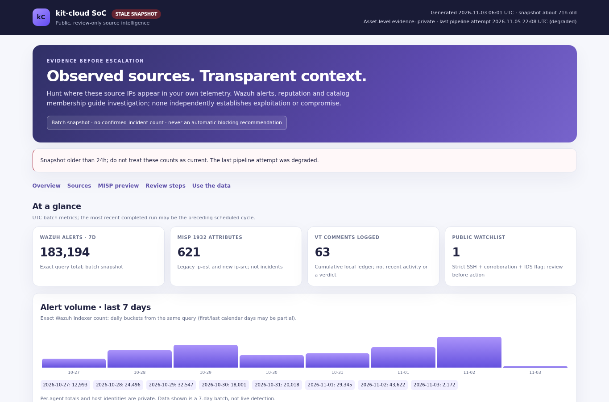
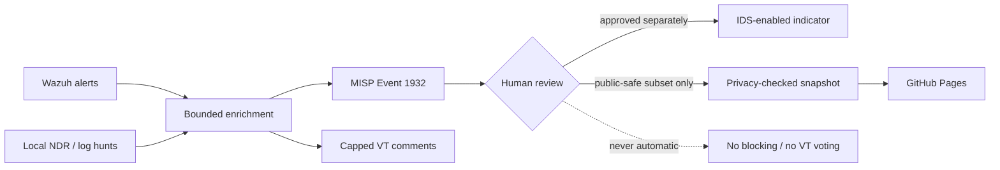

# kit-cloud SoC

**Evidence before escalation.** A homelab SOC pipeline connecting **Wazuh → local threat DB → GreyNoise/OTX/AbuseIPDB → MISP Event 1932 → cautiously filtered VirusTotal community comments**.

[**Open the review-only dashboard**](https://m0dred.github.io/kit-cloud-soc/) · [Public snapshot](docs/data.json) · [Offline tests](tests/run-offline.sh)


> The heartbeat and batch dashboard can be stale. Neither proves event freshness, compromise, or incident status. There is **no automatic blocking or VT voting**. New automated MISP attributes start with **IDS use disabled (`to_ids=false`)** until an analyst reviews them; older attributes are not changed automatically.


[](https://m0dred.github.io/kit-cloud-soc/)

*Illustrative snapshot from the existing public Pages dashboard. Open the live page for its current privacy-checked snapshot and explicit staleness warnings.*



## What is dynamic—and what is deliberately not

| Area | Automated behavior | Human boundary |
|---|---|---|
| Pipeline heartbeat | Existing `public-status.py` writes only `status.json`; Shields reads its public `state` and UTC attempt time for the README badges | Only `ok` / `degraded` / `unknown` and UTC last-attempt time; never error details |
| Public dashboard | Complete runs can update `docs/data.json` and `docs/blocklist.txt` after privacy checks | Last safe snapshot is retained on failure; public data is not a live detection feed |
| Failed runs | `--status-only` publishes only the sanitized heartbeat | No failure details, evidence, agent/victim data, or empty replacement snapshot |
| Code and workflow | Manual review, test, commit and push | Code/config is never auto-published |
| MISP and response | Enrichment and previews guide review | IDS flags, blocking and incident decisions require a separate verified human action |

## Review model

- **Observation is not compromise.** Wazuh totals, NDR samples and catalog membership are leads, not verdicts.
- **MISP knowledge is not local proof.** Event 1932 includes legacy `ip-dst` entries actually observed as inbound sources; new attributes use `ip-src`, and consumers support both during migration.
- **IDS use stays off by default for new automated attributes.** The MISP new-event helper also defaults to `to_ids=false`, reports add/publish failures and requires manual review of partial events.
- **Public watchlist is not a block command.** It requires MISP `to_ids=true`, corroborated SSH-source evidence and a non-cloud public IP. Older `to_ids=true` entries are not necessarily analyst-reviewed, and one public IP does not imply one MISP indicator.
- **Manual review records are not a Case system.** `reviews.sqlite3` keeps bounded private decisions with evidence references and expiry, but it never writes to MISP or GitHub. Approval, revocation and expiry reconciliation still need separate authenticated action.
- **Public output is bounded.** Per-agent data, raw events, detailed failures and private AS context remain private. The 24-hour top-500 coverage limit and enrichment age/status are explicit.

<details>
<summary><strong>Private MISP Warninglists context</strong></summary>

After the Wazuh 24-hour top-500 source fetch, `warninglist_context.py` reads four **public upstream** MISP CIDR warninglists (AWS, Azure, GCP, Cloudflare) over verified HTTPS and writes only source IP/provider-range matches to root-only `warninglist-context.json`.

The local MISP's built-in lists are disabled and some are older; this job **does not enable them or write to MISP**. A range match is *not* a benign verdict, an allowlist, independent evidence, or an auto-exclusion. No MISP/VT selection threshold, IDS flag, blocklist, public Pages data, or automated response reads these labels.

The report shows top-500 coverage and upstream list versions. If any list is unavailable, malformed or older than 60 days, it becomes `unavailable` with **no matches**, not a false no-match finding. Optional lookup is skipped on dry runs. The private report is ignored by Git and backed up with root-only archives.

</details>

<details>
<summary><strong>Schedule, publication and recovery</strong></summary>

- **UTC `06:00`, `12:00`, `18:00` and `22:00`:** `cron-run.sh` attempts Wazuh → MISP and local NDR/log hunts four times daily, including the independently capped VT comment job (`vt_comment_new.py`, **at most 3 per run / 6 per UTC day**). Dashboard generation requires successful stages. These are scheduled attempts, not a freshness guarantee; additional attempts can increase API load and failure notifications while sources are down.
- **GitHub sync:** publishes privacy-checked `docs/data.json`, `docs/blocklist.txt` and `docs/status.json` after a complete run. `--status-only` publishes only the sanitized heartbeat. A hard non-active Agent is a health failure on every run, including baseline; sleep-prone Agents remain warnings. Manager inventory is paginated and validated; a missing tracked Agent stays unknown until it reappears or an approved decommission is reconciled. Failed dashboard enrichment fallback fails the snapshot rather than silently publishing empty enrichment; DB-only AS context remains private.
- **Run history:** operator-verified status corrections are appended privately to the cron log, can only mark a completed run as failed, and appear in public run history on the next safe snapshot without exposing their reasons.
- **Local detailed dashboard:** lives in `dashboard/` and is ignored by Git. Private `ndr-evidence.json` retains bounded NDR alert samples and is not committed.
- **UTC `02:30`:** `backup.sh` writes a verified, root-only recovery archive to `/mnt/storage0/soc-backups`. It contains secrets and must never be uploaded. `backup-health.py` checks the current UTC day's archive after each SOC run and reports absent, corrupt or unsafe backups without forcing an otherwise safe public sync.
- UTC schedules move by one hour in Melbourne during daylight saving. No SSH keys are installed.
- GitHub Pages is **not** a backup of credentials or state.

</details>

<details>
<summary><strong>Code map</strong></summary>

| Path | Purpose |
|---|---|
| `cron-run.sh`, `backup.sh`, `backup-health.py`, `public-status.py`, `github-sync.sh` | Active jobs, public heartbeat/SVG and daily backup monitoring |
| `src/soc-connector/` | Reviewed snapshot of live skill code; active file is under `~/.config/agents/skills/soc-connector/scripts/` |
| `src/linux-log-threat-hunt/threat_db.py` | Snapshot of DB dependency; active copy lives under the skill |
| `ioc_comment.py` | One source comment template: fixed public behavior labels, raw rule/target withheld; VT-only fenced summary with references outside the fence |
| `warninglist_context.py` | Root-only, read-only provider-range context; no actions or sharing |
| `vt_comment_new.py` | Strict, capped VT posting and offline `--dry-run` preview |
| `ndr-cross.py`, `health-check.py`, `dashboard-gen.py` | Bounded private Wazuh/NDR evidence, health and split local/public dashboard |
| `docs/app.js`, `themes/issues-to-incidents.html`, `review-store.py` | Safe public DOM rendering; private read-only evidence and local manual IOC reviews |
| `tests/` | Offline regression/privacy, reviewed-IOC and healthy/degraded/stale-page tests |
| `config.example.yaml` | Placeholder config, **never** the real `config.yaml` |

Live code updates to the skill must be reviewed and copied into `src/` before a separate code commit. The local backup contains live code as well.

</details>

## Local verification

For a manual dry run of VT selection (no posts):

```bash
python3 vt_comment_new.py --dry-run --max 3 --days 7
python3 -m unittest discover -s tests -v
bash tests/run-offline.sh
```

The offline suite uses the reviewed `src/` snapshot and pinned PyYAML (`requirements-test.txt`). **GitHub Actions CI is not yet enabled**: the current push credential lacks permission to add workflow files.

To record a private manual decision:

```bash
python3 review-store.py record <PUBLIC_SOURCE_IP> \
  --verdict approve_ids --reviewer <ID> \
  --rationale '<20+ character evidence-based reason>' \
  --evidence-ref <PRIVATE_ALERT_REF> --expires <UTC_ISO_TIME>
```

This does **not** enable IDS flags in MISP. Verify the evidence and make that separate decision in an authenticated MISP session. Expiry and revocation in this ledger do **not** automatically clear an existing MISP flag. The reviewer identifier is self-declared and the local ledger is not a tamper-proof audited Case system.

Contact: admin@kit-cloud.com
